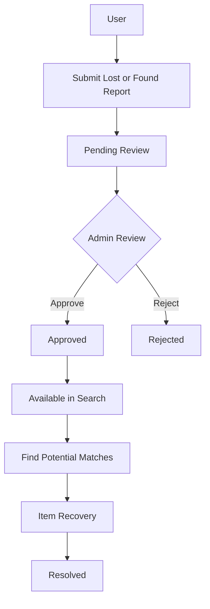

# LostAndFound

**A Lost and Found Management System built with ASP.NET Core and .NET 10.**

## 1. Project Overview

LostAndFound is a backend system designed to simplify the process of reporting, searching for, and recovering lost items.

The system provides a centralized platform where users can submit Lost and Found reports, browse approved reports, and discover potentially matching items.

It also provides an administrative workflow for reviewing submitted reports and managing their lifecycle.

The project focuses on building a maintainable backend system with clear business rules, structured architecture, and automated development workflows.

## 2. Project Goals

- Build a practical RESTful Web API using ASP.NET Core.
- Implement real-world business workflows and domain rules.
- Design a maintainable and well-organized backend architecture.
- Provide efficient report searching, filtering, and pagination.
- Implement a mechanism to identify potentially matching lost and found items.
- Handle authentication, authorization, and image uploads.
- Integrate asynchronous messaging using RabbitMQ.
- Containerize the application and its dependencies using Docker.
- Automate build, testing, and Docker image validation through CI.

## 3. Skills & Technologies

| Area | Technologies & Skills |
|---|---|
| Backend Development | C#, .NET 10, ASP.NET Core Web API |
| Database | SQL Server, Entity Framework Core, LINQ |
| Architecture | Layered Architecture, Separation of Concerns, Dependency Injection |
| API Design | RESTful APIs, DTOs, Repository Pattern, Pagination |
| Authentication | JWT, Refresh Tokens, Role-Based Authorization |
| Validation | FluentValidation |
| Messaging | RabbitMQ, Asynchronous Event Publishing |
| File Management | Image Upload and Local File Storage |
| Testing | xUnit, Unit Testing |
| Containerization | Docker, Docker Compose |
| CI/CD | GitHub Actions |
| Version Control | Git, GitHub, Branch Protection, Pull Requests |

## 4. System Workflow

The system follows a structured workflow to manage reports from submission to resolution.

### Main Workflow



### User Workflow

- Register and authenticate.
- Submit Lost or Found reports.
- Upload item images.
- Browse approved reports.
- Search and filter reports.
- View potentially matching reports.
- Track personal report statuses.

### Admin Workflow

- View pending reports.
- Review submitted report details.
- Approve or reject reports.
- Resolve approved reports when the recovery process is completed.

### Report Visibility

Only approved reports are available through public browsing and search. Administrative operations are protected by role-based authorization.

## 5. Architecture & Project Structure

The project follows a layered architecture that separates business logic, application functionality, infrastructure concerns, and API responsibilities.

### Solution Structure

```text
LostAndFound/
│
├── LostAndFound.Api/
│   ├── Controllers/
│   ├── Extensions/
│   └── Program.cs
│
├── LostAndFound.Application/
│   ├── Common/
│   ├── Features/
│   │   ├── Auth/
│   │   ├── Categories/
│   │   ├── Locations/
│   │   └── Reports/
│   └── Messaging/
│
├── LostAndFound.Domain/
│   ├── Entities/
│   ├── Enums/
│   └── Exceptions/
│
├── LostAndFound.Infrastructure/
│   ├── Common/
│   ├── Messaging/
│   ├── Options/
│   ├── Persistence/
│   └── Storage/
│
├── LostAndFound.Tests/
│   ├── Domain/
│   └── Features/
│
├── .github/
│   └── workflows/
│       └── ci.yml
│
├── Dockerfile
├── compose.yaml
├── .dockerignore
└── LostAndFound.slnx
```

### Layer Responsibilities

| Project | Responsibility |
|---|---|
| **LostAndFound.Api** | HTTP endpoints, controllers, middleware pipeline, and application configuration. |
| **LostAndFound.Application** | Application services, use cases, DTOs, validation, interfaces, and mappings. |
| **LostAndFound.Domain** | Core business entities, enums, domain rules, and domain exceptions. |
| **LostAndFound.Infrastructure** | Database access, EF Core configurations, repositories, image storage, and RabbitMQ integration. |
| **LostAndFound.Tests** | Unit tests for important domain and application logic. |

The architecture promotes separation of concerns and keeps core business rules independent of infrastructure implementation details.

## 6. Key Features

- **Authentication & Authorization:** JWT authentication, refresh tokens, and role-based access.
- **Report Management:** Create and manage Lost and Found reports with image uploads.
- **Administrative Review:** Approve, reject, and resolve reports through controlled status transitions.
- **Search & Filtering:** Search approved reports using keywords, categories, locations, and report types.
- **Pagination & Sorting:** Retrieve reports efficiently with configurable pagination and sorting.
- **Similarity Matching:** Identify and rank potentially matching Lost and Found reports.
- **Category Management:** Organize reports using categories and subcategories.
- **Location Management:** Associate reports with predefined locations.
- **Event Publishing:** Publish report-related events through RabbitMQ.

## 7. Docker & Containerization

The project uses Docker Compose to orchestrate the application and its supporting services.

The environment includes:

- ASP.NET Core API.
- SQL Server.
- RabbitMQ.

Docker volumes provide persistent storage for database data, RabbitMQ data, and uploaded images.

The services communicate through a dedicated Docker network.

## 8. CI/CD Pipeline

GitHub Actions automates the project's Continuous Integration workflow.

The pipeline runs on pushes and pull requests targeting the `main` branch.

### Build and Test

- Checkout repository.
- Set up .NET 10 SDK.
- Restore NuGet dependencies.
- Build the solution in Release configuration.
- Run unit tests.

### Docker Build

- Build the API Docker image.
- Validate the Docker build process.

### Branch Protection

The `main` branch is protected using GitHub Rulesets:

- Pull requests are required before merging.
- Build and Test checks must pass.
- Docker Build checks must pass.
- Force pushes are blocked.
- Branch deletion is restricted.

## 9. Testing

The project uses **xUnit** for unit testing.

Current tests focus on important business logic, including:

- Report creation and initial status.
- Valid and invalid report state transitions.
- Similarity calculation.
- Similarity weight redistribution when private descriptions are unavailable.

The tests help verify critical business behavior independently of external infrastructure.

---

**Built with C#, ASP.NET Core, and .NET 10.**
